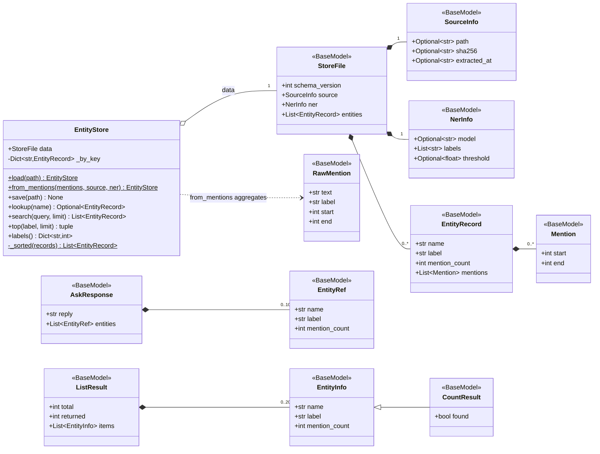
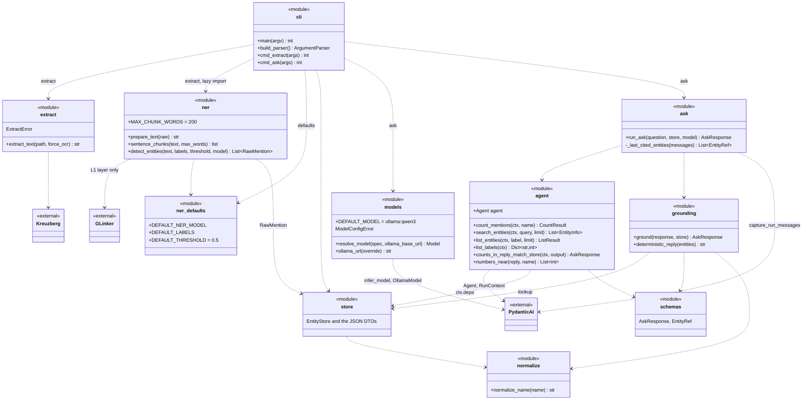
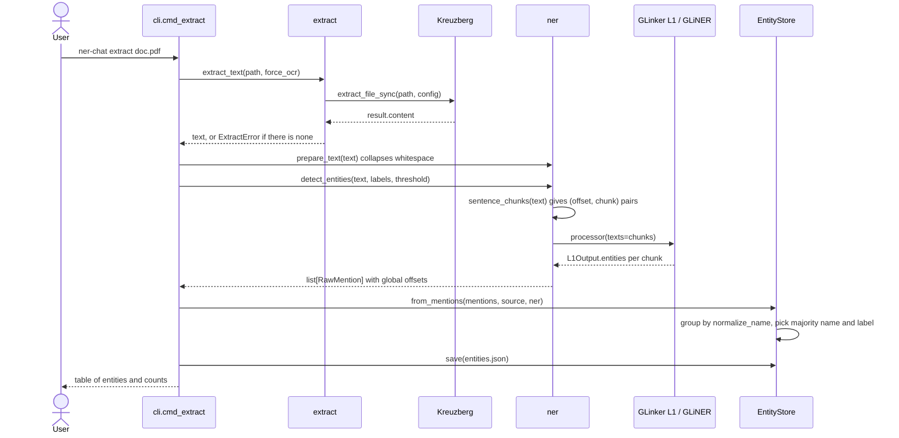
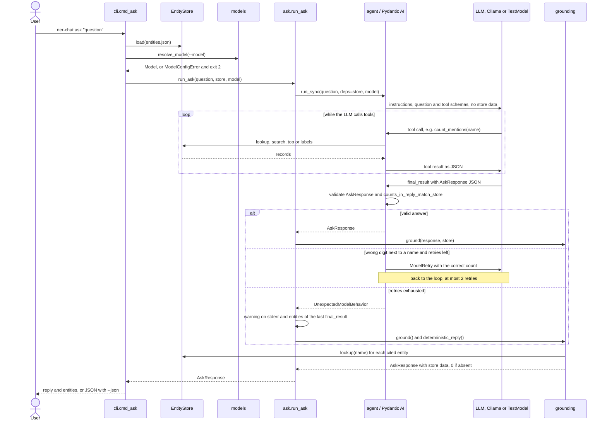

# Architecture of `ner_chat`

UML diagrams of `src/ner_chat`, in Mermaid (GitHub renders them). Notation:

| Notation | Meaning |
|---|---|
| `<<BaseModel>>` | Pydantic DTO, validated on construction |
| `<<module>>` | a `.py` file: module-level functions and variables (like a class with `static` members) |
| `<<external>>` | third-party library |
| `method$` | static: `@classmethod` or `@staticmethod` |
| `-member` | private by convention (leading `_`) |
| `Optional~T~` | `T \| None` |

## 1. Data model

`StoreFile` is the format of `entities.json`; `EntityStore` wraps it with an index by normalized name.
`AskResponse` is the structured output of `ask`; `EntityInfo`, `CountResult` and `ListResult` are what the tools
return to the LLM.

## 2. Modules and dependencies

Dashed arrows mean "uses". `cli` imports `extract` and `ner` only inside the extract command, so `ask` never loads
GLinker or torch.

## 3. `extract` sequence

From file to JSON. Each mention's offset is added to its chunk's offset, so offsets refer to the whole normalized
text.

## 4. `ask` sequence

The LLM never receives the inventory in its prompt, only what tools return. Grounding is applied in code after the
run, on both the normal and the fallback path.

